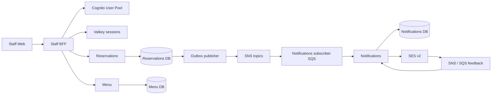

# MiseWorks architecture

## 1. Purpose and status

Recorded 2026-10-26. This document separates the **existing baseline**, the **agreed target**, and **proposals awaiting confirmation**. It guides incremental implementation; it is not a production-readiness claim.

[PRD.md](PRD.md) is authoritative for product behavior. No applicable repository `AGENTS.md`, earlier architecture document, or ADR was found during the handover. The existing PRD and prompt edits were preserved. No business workflows were implemented in this review.

## 2. Product boundary

The MVP serves **one restaurant at one location**. It supports managers and service staff, staff-entered reservations, walk-ins, staff-selected table combinations, explicit occupancy/release, manual conflict resolution, menu maintenance, restaurant configuration, and staff access administration. Guests receive confirmation/cancellation emails when they supply email; booking does not depend on email success.

Expected departure does not release a table. Planned allocation overlap prevention and warnings about actual occupancy overruns are distinct requirements. There is no automatic allocation/reassignment, public booking, public self-registration, external booking integration, POS/payment, inventory, SMS, or messaging-app integration. See the PRD for exact scope and open product questions. No tenant/location abstraction is required for the MVP.

## 3. Architecture and rationale

The agreed target is a monorepo of independently buildable/deployable microservices on AWS. Reservations keeps availability, allocation, tables, and occupancy in one database transaction boundary so concurrent allocations can be prevented atomically. Menu and Notifications have separate lifecycles and data ownership. The BFF provides the browser security and composition boundary.



This diagram describes the target, not deployed resources. The outbox publisher belongs to the owning service and reads only its database. No modular monolith, Kubernetes, Kafka, service mesh, extra API gateway, or Spring Modulith is selected. Internal modules within a service are appropriate.

## 4. Repository organization and existing implementation

`services/reservations-service/` and `apps/staff-bff/` exist as independently buildable applications. Reservations contains a Maven build/wrapper, Boot entry point, YAML configuration, PostgreSQL Testcontainers setup, and baseline smoke tests. Its package remains `com.miseworks.reservations`; artifact and application name are `reservations-service`, version `1.0.0` (scaffold metadata, not a released product).

The source and generated HELP links are consistent with Initializr, with additional build tooling; exact generation provenance is not independently established. No ProGen users module, password/JWT issuer, JJWT, Modulith, BootUI, domain entities/controllers, or SQL migrations were found. There is no old `services/reservation-service` tree, nested Git repository, service-local CI, Compose file, Terraform, or frontend. IDE files and `target/` are ignored. A heuristic secret-pattern review found no apparent credential values in tracked documents or the candidate scaffold; it is not a comprehensive credential audit.

Existing and planned paths (planned applications are created only when needed):

| Path | Purpose |
|---|---|
| `apps/staff-web/` | React staff application |
| `apps/staff-bff/` | Existing local OIDC login and shared sessions; API composition pending |
| `services/reservations-service/` | Existing baseline |
| `services/menu-service/` | Menu domain |
| `services/notification-service/` | Guest email processing |
| `contracts/events/` | Deliberate versioned event contracts |
| `infrastructure/local/` | Docker Compose and emulator configuration |
| `infrastructure/terraform/` | AWS infrastructure |
| `docs/` | PRD, architecture, decisions, prompts |

Each backend application gets its own build and Maven Wrapper. A root Maven aggregator is not currently needed. Applications are scaffolded incrementally; no placeholder infrastructure is added to imitate this tree.

### Staff BFF local authentication (2026-10-26)

`apps/staff-bff/` uses package `com.miseworks.staffbff`, artifact/application name `staff-bff`, and scaffold version `1.0.0`. It retains the Reservations Java 25, Boot 4.1.2, Maven Wrapper, formatting, coverage, build-info and restricted Git metadata conventions. It includes MVC, validation, Actuator, OpenAPI, OAuth2 Client and Boot-managed Spring Session Redis. There is no domain database. Default HTTP port is 8081.

Cognito Authorization Code login now uses S256 PKCE and a confidential client. The browser receives an HttpOnly, SameSite=Lax session cookie; security context and authorized-client access/refresh tokens live in Valkey. Login rotates the session ID. Initial configurable timeouts are 30 minutes idle and 8 hours absolute from session creation. CSRF-protected logout deletes the shared session and redirects through Cognito browser logout. It does not revoke all existing tokens/sessions. `/api/session` exposes only the authenticated subject; `/api/csrf` supplies the mutation token. Health and OpenAPI remain protected. Secure cookies are the default; the explicit loopback-only local profile permits HTTP.

`infrastructure/local/compose.yaml` runs Floci 2.3.0 and Valkey 8.1.3-alpine on loopback ports with named volumes. Python bootstrap creates the local pool/client/development user and writes generated credentials to an ignored mode-600 `.env`. Valkey is a direct Compose service in this phase, avoiding a host Docker socket mount into Floci; ElastiCache control-plane emulation remains untested. Browser and host BFF use consistent localhost discovery, issuer, callback and JWKS URLs. See [local setup](../infrastructure/local/README.md) and [BFF details](../apps/staff-bff/README.md).

Automated tests use their own disposable Floci/Valkey containers. The selected test adapter 2.16.1 and Spring Cloud AWS BOM 4.2.0 are included in the BFF; no AWS runtime client is needed for OIDC. Redis uses a Boot service connection; OIDC networking is configured explicitly because Floci advertises a fixed base URL while Testcontainers assigns random ports. Tests preserve the exact issued-token issuer, signature and nonce checks; they do not disable validation. Local packaged-app verification separately exercises actual discovery.

Verification: all 12 tests passed with no failures/errors/skips; formatting, packaging and the unchanged 40% coverage gate passed. Real login/code exchange, PKCE/state/password rejection, session rotation, server-side token storage, CSRF logout and idle expiry are covered; clock-controlled tests cover absolute expiry. A separate HTTP/cookie-jar smoke check passed against the packaged local application and a temporary second BFF process: both recognized the same login, and logout removed access through both and cleared the Floci browser session. Bootstrap repeatability also passed. These are HTTP integration checks, not Playwright/browser UI tests or AWS validation.

Automatic token refresh/concurrent refresh policy, role mapping, staff deactivation/all-session invalidation, revocation guarantees and downstream bearer propagation remain pending. This phase does not complete production authentication/authorization.

## 5. Responsibilities and data ownership

| Application | Agreed responsibilities | Persistent ownership |
|---|---|---|
| Reservations | Tables/capacity, availability, staff allocation, reservation lifecycle, walk-ins, seating, occupancy/release | Reservations database and service-owned Flyway migrations |
| Menu | PRD menu categories, dishes, descriptions, prices, manual availability | Menu database and migrations |
| Notifications | Prepare/submit email, notification records, attempts/outcomes, delivery feedback | Notifications database and migrations |
| Staff BFF | OIDC integration, browser sessions, frontend composition, authenticated downstream requests | Shared BFF session storage only; no domain database for forwarding |
| Staff Web | Manager/staff workflows, local interaction state | No authoritative domain data |
| Cognito | Credentials, authentication, identity lifecycle and identity-provider groups/claims | Managed identity data; not restaurant business configuration |

Every data-owning service has separate database credentials. One PostgreSQL instance can host separate local databases. No cross-service table access, joins, shared JPA entities, or shared repositories. Contracts may be shared deliberately without sharing domain internals. Domain rules belong outside controllers and outside the BFF.

**Proposal requiring confirmation:** put restaurant settings (hours, default visit duration, restaurant profile) and application staff-access records in separate internal Reservations modules. Configuration affects reservation rules directly. Staff-access records would map Cognito subject IDs to application status/roles, without passwords or token issuance. The BFF would coordinate authorized Cognito account operations and Reservations commands; Reservations would own business authorization and durable application records. This is the smallest arrangement using the already selected applications; it adds no service and no BFF domain database.

Cognito operations and application writes are not atomic. Provisioning/deactivation must have explicit retry/reconciliation states and recovery. Precise staff fields, authoritative role source, authorization checks across Menu/Reservations, and propagation/invalidation policy must be settled before implementation. The proposal does not yet authorize a shared access database or synchronous access-service dependency for every request. If the proposal is declined, record an explicit alternative ownership decision before implementing administration.

## 6. Technology choices

Backend target: Java 25, Spring Boot, Maven Wrapper, Spring MVC REST, Spring Data JPA/Hibernate, PostgreSQL, Flyway per service, springdoc OpenAPI, Actuator, structured logs, metrics, distributed tracing, JUnit, and Testcontainers. Existing dependencies cover MVC/JPA/validation/Flyway/Actuator/resource server/OpenAPI/testing. Resource-server starter already supplies both JWT resource-server and JOSE support; a second starter or JJWT is unnecessary.

Frontend target: React, TypeScript, Vite, React Router, TanStack Query, React Hook Form, Zod, shadcn/ui, Tailwind CSS, Vitest, React Testing Library, and Playwright. Use npm with committed lockfile. Begin with local React state for interaction state. **No frontend/Node/npm versions have been selected or verified.**

## 7. Version inventory and dependency management

Evidence date: 2026-10-26. Versions below come from the actual POM, wrapper, effective POM and dependency tree, then local compilation/runtime checks. Historical ProGen output was not used to select them.

| Technology | Selected/configured version | Evidence and remaining validation |
|---|---|---|
| Java | Compiler release 25; SDKMAN `25.0.4-librca` | Installed BellSoft OpenJDK 25.0.4; wrapper uses it; compilation/test runtime checked. Replaces scaffold Java 27. |
| Maven | 3.10.0; Wrapper 3.3.4, script-only | `./mvnw --version`; official release notes; exceeds Boot minimum 3.6.3. |
| Spring Boot | Parent/BOM 4.1.2, retained | Official requirements support Java 17–27 and Framework 7.0.10+; baseline build/runtime checked. |
| Spring Framework / Security | Boot-managed 7.0.10 / 7.1.2 | Effective management and resolved tree aligned; no independent overrides. Cognito claim contract not tested. |
| Hibernate | Boot-managed 7.4.13.Final | JPA initialization against PostgreSQL 18.6; no entities yet. |
| PostgreSQL server | Major 18 baseline; test image `postgres:18-alpine` | Actual container reported 18.6. Mutable tag retained; immutable image/digest and RDS engine minor/region support pending. |
| PostgreSQL JDBC | Boot-managed 42.7.14 | Connection and SQL against PostgreSQL 18.6. |
| Flyway core / PostgreSQL module | Both Boot-managed 12.4.0 | Official PostgreSQL module requirement; runtime validation/history initialization on 18.6. No business migration exists. |
| Testcontainers | Boot-managed BOM 2.0.5 | Core, JUnit Jupiter, PostgreSQL modules aligned; real Docker container tested. |
| Floci integration tests | Recorded integration coordinates: `io.floci:spring-boot-testcontainers-floci:2.16.1`, test scope | Add to applications when tests need Floci. Not configured in the current PostgreSQL-only Reservations baseline; Floci runtime/service-connection validation pending. |
| JUnit Jupiter | Boot-managed 6.0.3 | Surefire executed baseline tests; not independently pinned. |
| OpenAPI | springdoc WebMVC UI 3.1.0, retained explicit dependency | Official matrix supports 3.1.x–3.2.x with Boot 4.1.x; serialization smoke check. |
| Build/test plugins | Boot 4.1.2; Compiler 3.15.0; Surefire 3.5.6; Failsafe managed 3.5.6 | Effective POM; Failsafe is not activated. Release 25; parameter metadata inherited. |
| Existing build tooling | JaCoCo 0.8.15; Spotless 3.10.4; Palantir formatter 2.102.0; git-commit-id 9.2.0 | Retained; formatter and coverage gate run. Git metadata restricted to branch/abbreviated commit. |
| AWS libraries | Recorded BOM: Spring Cloud AWS 4.2.0; AWS SDK for Java v2 intended, SES v2 client in Notifications | Import the BOM in applications that use Spring Cloud AWS. No AWS BOM/client is configured in Reservations today; SDK/service runtime validation remains pending. |
| Local BFF authentication | Floci 2.3.0; Valkey 8.1.3-alpine; Boot-managed Spring Session 4.1.1 / Security 7.1.2 | Local Compose and isolated-container login/session checks passed; AWS deployment and ElastiCache management untested. |
| Remaining platforms | SNS/SQS, SES, Mailpit, Terraform, ECS/RDS | Agreed technologies; runtime configurations not selected or validated here. |
| Frontend | Stack agreed; all versions pending | Select compatible stable versions when generating the frontend and commit npm lockfile. |

Use Boot dependency management for its libraries and build plugins. Keep explicit versions for direct dependencies/tooling outside that management, not individual transitive JARs. When an application needs Spring Cloud AWS, use its recorded 4.2.0 BOM and verify effective management alongside Boot rather than independently pinning transitive AWS libraries. Architecture-level choices do not require unused dependencies in every application. Do not introduce snapshots/milestones or broadly upgrade dependencies without a reason.

### Maven repository warnings

The initial `dependency:tree` reproduced HTTP 401 metadata-prefix warnings for `flyway-community-db-support` and `MavenFeed`. Both repository definitions are in the resolved `org.flywaydb:flyway-parent:12.4.0` POM (also present in older cached Flyway parents). The application's effective dependency/plugin repositories contain only Maven Central; user `~/.m2/settings.xml` is absent and wrapper global settings contain the standard HTTP blocker. The application declares no custom repositories.

These are upstream repository declarations encountered during Maven prefix discovery, not evidence that this project needs private-repository credentials. Resolution and verification can succeed despite the warnings. No credentials, dependency-parent cache edits, or global mirror were added. Prefer fully qualified plugin goals when diagnosing prefix discovery; introduce a project repository policy only for an observed need, with its scope understood.

Primary compatibility references consulted on 2026-10-26:

- [Spring Boot 4.1 system requirements](https://docs.spring.io/spring-boot/4.1/system-requirements.html).
- [Maven 3.10.0 release notes](https://maven.apache.org/docs/3.10.0/release-notes.html).
- [springdoc compatibility matrix](https://springdoc.org/#what-is-the-compatibility-matrix-of-springdoc-openapi-with-spring-boot).
- [Flyway PostgreSQL support/module](https://documentation.red-gate.com/flyway/reference/database-driver-reference/postgresql-database).
- [Testcontainers PostgreSQL module](https://java.testcontainers.org/modules/databases/postgres/).
- [Spring Security JWT resource server](https://docs.spring.io/spring-security/reference/servlet/oauth2/resource-server/jwt.html).

The documentation establishes supported combinations; the build and smoke tests provide narrower, concrete runtime evidence. Neither proves every future integration.

## 8. Authentication, authorization and sessions

**Agreed target:** OIDC via Staff BFF and Cognito User Pools, Authorization Code with PKCE, Spring Security OAuth2 Client. Tokens stay server-side. Browser uses an HttpOnly session cookie; deployed cookies require Secure, deliberate SameSite/domain/path settings, TLS, and CSRF protection for cookie-authenticated mutations. Staff Web calls the BFF; domain services are not the intended browser boundary. No custom password login, replacement JWTs, or Cognito Identity Pools.

Use Spring Session Data Redis backed by ElastiCache for Valkey; session storage is shared among BFF replicas only. Local session storage, initial idle/absolute expiry and current-session/provider-browser logout are implemented. Settle production expiry policy, token refresh/concurrent refresh behavior, role changes, staff deactivation and invalidation of all active sessions before completing authentication.

Domain services independently validate **access tokens**, including trusted issuer, signature/algorithm/key rotation, expiry, `token_use=access`, and the intended client/resource constraints. Cognito access tokens use `client_id`; resource-bound tokens may also contain `aud`. Do not apply an ID-token audience contract blindly. Deliberately map groups/scopes to manager/staff permissions and test negative cases. See [Cognito access token contract](https://docs.aws.amazon.com/cognito/latest/developerguide/amazon-cognito-user-pools-using-the-access-token.html).

Disabling users/revoking tokens at Cognito does not cause offline JWT signature/expiry validation to reject every existing token. See [Cognito revocation limitations](https://docs.aws.amazon.com/cognito/latest/developerguide/token-revocation.html). Decide an acceptable revocation delay and how services enforce it (for example, bounded token lifetimes plus an explicit application access-status/version policy). Session deletion alone does not prevent direct use of a previously issued bearer token. This tradeoff remains open; do not promise immediate deactivation yet.

**Existing baseline:** `COGNITO_ISSUER_URI` is required externally and triggers Boot JWT resource-server auto-configuration. Tests use an unreachable reserved `.invalid` issuer so unauthenticated rejection requires no identity-provider network call. Both `/v3/api-docs` and `/actuator/health` reject anonymous HTTP requests with 401. Health and OpenAPI are checked with test-only mock authentication. The BFF now verifies local OIDC login and Valkey sessions as described in section 4. Reservations still lacks verified access-token acceptance, explicit role mapping and Cognito token-use/client checks. There is no completed production security policy. Do not deploy this baseline as completed Cognito authorization. Decide a minimal probe exposure policy when deployment health checks are introduced.

## 9. REST and asynchronous communication

REST handles interactions requiring immediate results, including BFF requests and domain commands/queries. Configure explicit connect/read/overall deadlines, propagate correlation context, and bound any retries. Do not retry non-idempotent commands blindly. APIs need deliberate error/validation contracts, authorization rules, and OpenAPI descriptions during implementation.

Domain events use SNS topics with separate SQS subscriber queues and DLQs. A subscriber owns its queue and consumption policy. Contracts will live under `contracts/events/`: define identifiers, schema versions, aggregate identity/version, timestamps, correlation/causation, and the minimum required payload. Avoid unnecessary guest data. Topic names, event schemas and compatibility rules are not implemented or finalized.

## 10. Outbox and consumer reliability

Commit business changes and an outbox row in the same owning database transaction. A service-owned relay publishes committed rows, then records progress. A crash between publication and marking completion can republish: delivery is at least once, not exactly once. No event library alone supplies this design.

Consumers persist duplicate protection and relevant local changes atomically; acknowledge SQS only after successful durable processing. Choose deduplication keys/retention, visibility timeout, bounded retry/backoff, maximum receives, DLQ alarms and controlled replay procedures during implementation. Treat poison messages explicitly. Events may arrive out of business order: define per-aggregate version handling and stale/missing-event policy, including confirmation/cancellation races, before shipping consumers. No global business ordering is assumed.

Database updates and external API calls are not one transaction. Reliable event processing does not imply exactly-once SES sending. No outbox/relay/consumer is present today.

## 11. Guest email and feedback

Reservation confirmation and cancellation events trigger Notifications through SNS/SQS. Missing email is a valid reservation case. Notifications owns preparation, durable records, attempts, provider message IDs and feedback correlation. SES v2 submission uses AWS SDK for Java v2. Booking commits independently of sending, retries, bounce or complaint outcomes.

Separate queued/prepared/submitted states from delivery, bounce, complaint and failure evidence. SES API acceptance is not inbox delivery; provider delivery feedback is not proof a guest read the message. SES feedback is intended through SNS and subscriber SQS to Notifications. Duplicate and late feedback must be handled. See [SES event notifications](https://docs.aws.amazon.com/ses/latest/dg/monitor-sending-activity-using-notifications.html).

Use bounded retries and duplicate protection. An ambiguous send response can leave uncertainty about acceptance and duplicate-send risk; select a recovery/manual review policy instead of claiming exactly-once email delivery. Retention and suppression/bounce/complaint handling need explicit requirements. Amendment emails remain a PRD open question.

Locally use Floci SES with Mailpit capture. Real inbox delivery requires real SES: verify sender/domain, configure DKIM/SPF/DMARC appropriately, account for sandbox/production access, region/quotas, feedback setup and least-privilege task roles. [SES sandbox requirements](https://docs.aws.amazon.com/ses/latest/dg/request-production-access.html) are deployment work, not a blocker for local development. No real email was sent in this review.

## 12. Local development topology

**Target:** [Floci (floci.io)](https://floci.io/) is the selected local AWS emulator. Docker Compose orchestrates applications, PostgreSQL with separate service databases/users, Floci supported Cognito/ElastiCache/SNS/SQS/SES behavior, Valkey-compatible session connectivity, and Mailpit. Applications may run from IntelliJ while infrastructure runs in containers. Keep browser-visible issuer URLs consistent with container-visible discovery/JWKS routing; do not disable issuer checks to solve hostname mismatches.

[Floci AWS documentation](https://floci.io/aws/) describes its local AWS endpoint and service support. Its selected version, exact Cognito OIDC/PKCE support, ElastiCache engine/Valkey behavior, SES-to-Mailpit wiring and feedback support must be tested before relying on them. An advertised service name does not establish coverage of every required API. Keep any discovered emulation gaps explicit; do not silently substitute a different identity provider or claim AWS parity.

**Today:** Compose provides Floci Cognito and a direct Valkey service for local BFF sessions (see section 4); PostgreSQL, Mailpit and other local integrations are still pending. In Reservations, `./mvnw clean verify` uses disposable Testcontainers PostgreSQL; `./mvnw spring-boot:test-run` can use the existing test launcher plus an externally supplied issuer. Normal Reservations startup also requires external datasource URL/user/password. The Staff BFF local profile uses Compose; its verification starts isolated Floci/Valkey Testcontainers. No database credentials are committed. Hibernate uses `ddl-auto=validate` and Open Session in View is disabled; schema evolution belongs to Flyway.

### Floci integration tests and Spring Boot service connections

Use Compose for the shared local development environment and Testcontainers-managed Floci containers for isolated automated AWS integration tests. Tests must start their own required emulator resources and configure local endpoints/dummy credentials explicitly or through supported service connections; they must not depend on a developer's running Compose environment or fall back to real AWS. Pin the tested emulator image when implementing this setup.

The [Floci Java guide](https://floci.io/floci/testcontainers/java/) documents `FlociContainer` and Spring Boot `@ServiceConnection` integration. Spring Boot's existing `spring-boot-testcontainers` dependency supplies the service-connection framework; it does not itself supply the Floci container or adapter. Keep direct AWS SDK clients pointed at the container's endpoint, region and dummy credentials when an auto-configuration adapter does not cover them.

**Recorded integration setup, applied per application when needed:** use `io.floci:spring-boot-testcontainers-floci:2.16.1` in test scope and import `io.awspring.cloud:spring-cloud-aws-dependencies:4.2.0` as the AWS BOM. These coordinates document the intended integration setup, not a requirement for every service POM. The [published adapter POM](https://central.sonatype.com/artifact/io.floci/spring-boot-testcontainers-floci/2.16.1) identifies its core Floci and Boot Testcontainers dependencies and optional Spring Cloud AWS auto-configuration integration. Do not replace the selected adapter merely because newer upstream development uses different coordinates.

The [upstream main-branch README](https://github.com/floci-io/testcontainers-floci#spring-boot-integration) describes a transition to Spring Cloud AWS's own Testcontainers adapter. That is future upgrade context, not the selected setup here. Published-release behavior and this repository's tests determine the evidence for the pinned combination.

The corresponding Maven configuration for an application that needs this integration is:

```xml
<properties>
  <spring-cloud-aws.version>4.2.0</spring-cloud-aws.version>
  <spring-boot-floci-tc.version>2.16.1</spring-boot-floci-tc.version>
</properties>
<dependencyManagement>
  <dependencies>
    <dependency>
      <groupId>io.awspring.cloud</groupId>
      <artifactId>spring-cloud-aws-dependencies</artifactId>
      <version>${spring-cloud-aws.version}</version>
      <type>pom</type>
      <scope>import</scope>
    </dependency>
  </dependencies>
</dependencyManagement>
<dependencies>
  <dependency>
    <groupId>io.floci</groupId>
    <artifactId>spring-boot-testcontainers-floci</artifactId>
    <version>${spring-boot-floci-tc.version}</version>
    <scope>test</scope>
  </dependency>
</dependencies>
```

A temporary dependency-resolution/build check on 2026-10-26 passed with these coordinates: four existing PostgreSQL smoke tests passed, and Framework 7.0.10, Security 7.1.2 and Testcontainers 2.0.5 remained aligned with Boot. This did not exercise Floci. The BOM and adapter were subsequently removed from Reservations because its current code/tests do not use AWS/Floci. There is no Floci container bean or service-connection test yet. Spring Cloud AWS auto-configuration is optional in the adapter; add the required integration/client dependencies when implementing tests that use it.

Reservations will need AWS-related dependencies when its outbox publisher uses SNS and may then need Floci for integration testing. Add those dependencies with that implementation. Cognito JWT validation alone does not require an AWS SDK or a Spring Cloud AWS starter. BFF OIDC and session tests may use Floci, but AWS SDK service-connection wiring does not automatically configure Spring Security's OIDC issuer/client or Spring Session's Valkey connection. Configure and test those explicitly. Preserve PostgreSQL Testcontainers tests independently; add Floci tests during the authentication/messaging/email phases for the APIs each phase uses.

## 13. Local-to-AWS mapping

| Local target | AWS target | Validation still required |
|---|---|---|
| Application containers | ECS/Fargate | Image/JDK, task definitions, scaling, health and rollout |
| PostgreSQL service databases | RDS PostgreSQL | Engine minor availability, migrations, backups, TLS, credentials |
| Floci Cognito | Cognito User Pools | OIDC endpoints, PKCE, claims, refresh/logout, administration |
| Floci ElastiCache / Valkey-compatible sessions | ElastiCache for Valkey | Engine/protocol, TLS/authentication, failover/session behavior |
| Floci SNS/SQS | SNS/SQS | IAM, queue/topic policies, retries/DLQs, limits |
| Floci SES + Mailpit | Real SES | Verified identity, sandbox access, inbox delivery, feedback |

Emulation validates supported local behavior. IAM, VPC networking, TLS, quotas, regional availability and deployment behavior still require actual AWS validation with explicit authorization.

## 14. Deployment, configuration and secrets

Terraform will own infrastructure. Independently version/build container artifacts and deploy backend applications on ECS/Fargate; use RDS PostgreSQL and ElastiCache for Valkey. Frontend hosting, ingress/load balancer, DNS/TLS, network topology, availability targets and environment layout remain to be selected. Do not add an API gateway by default.

Use external environment configuration and a managed secrets mechanism (proposed AWS Secrets Manager or SSM secure parameters; exact choice pending). Use ECS task roles and least-privilege service permissions, not long-lived application AWS keys. Isolate local dummy credentials and emulator endpoints from real AWS environments. Never embed credentials in tracked YAML, images, logs or Terraform variables/state checked into Git. Protect remote state and define migration rollout/rollback, backups and recovery before deployment. No Terraform, cloud resources or deployment pipeline currently exists.

## 15. Observability

Target structured logs with service/environment/version, correlation/trace IDs and useful event/outbox/attempt identifiers. Keep guest details, passwords, cookies, bearer/refresh tokens and email bodies out of logs. Use Actuator/Micrometer metrics and distributed tracing across REST and message processing. Select compatible tracing bridge/exporter and collector/backend during implementation.

Measure allocation conflicts, overrun warnings, outbox lag, consumer retries/DLQs, notification submission and feedback outcomes, and operational health. Alert thresholds/retention are pending. Existing Actuator/default metrics are available; structured JSON logs, trace export, dashboards and alerting have not been configured or verified.

## 16. Testing and handover verification

Run from `services/reservations-service/` with JDK 25 and usable Docker:

```sh
./mvnw --version
./mvnw help:effective-pom -Dverbose -Doutput=target/effective-pom.xml
./mvnw dependency:tree
./mvnw clean verify
```

Spotless checks formatting during compile; use `./mvnw spotless:apply` to apply it. JaCoCo retains the existing 40% line threshold, with no exclusions added. Coverage of a Boot entry point does not measure business correctness.

The baseline test uses `useMainMethod=ALWAYS`, starts a real embedded HTTP server and PostgreSQL 18, checks anonymous rejection, queries Flyway history/server version, and checks health/OpenAPI JSON with test-only authenticated MockMvc requests. The reserved issuer and mock principal do not test JWT acceptance, keys, Cognito or role claims.

| Check | Handover outcome |
|---|---|
| Wrapper/JDK | Passed: Maven 3.10.0 / Java 25.0.4 |
| Dependency tree/effective POM | Passed; inherited alignment inspected; upstream metadata 401 warnings reproduced/located |
| Docker | Sandbox socket denied; daemon 29.9.2 available with approved execution outside sandbox |
| Compilation, formatting, packaging, coverage | Passed: final wrapper `spotless:apply clean verify`; 4 tests, 0 failures/errors/skips; 40% coverage gate met |
| Unit / architecture tests | None exist; not claimed |
| PostgreSQL integration smoke tests | Passed: 4 tests in `ReservationsApplicationTests`, run by Surefire; no skip/profile exclusion |
| Failsafe | Managed but not activated; no `*IT` tests exist, so no separate Failsafe run |
| Flyway | Engine validated zero migrations and created empty schema history; no business SQL migration available to execute |
| Packaged artifact standalone startup | Not separately run; main-method/server startup covered inside SpringBootTest |
| Business APIs / concurrency | Not yet applicable; no business endpoints/entities |
| Reservations Cognito access-token validation, SNS/SQS, SES, Mailpit, browser UI, Terraform/AWS | Not run; not configured |
| BFF local Cognito/Valkey (subsequent phase) | Passed: 12 automated tests plus packaged-app login/logout and shared-session smoke check across two processes; see section 4 |

Final verification completed on 2026-10-26: **BUILD SUCCESS**, four tests with no failures, errors or skips. The only production class (the three-line Boot entry point) had 100% line coverage; this is baseline evidence only. Reports are generated under `services/reservations-service/target/surefire-reports/` and `target/site/jacoco/` and are intentionally ignored. Temporary dependency/effective-POM/build logs used in this review are under `/tmp/miseworks-*` and are not durable project artifacts.

Initial verification passed the original context check but failed coverage (33% versus 40%). Exercising the actual main method and meaningful baseline checks addresses this without reducing the gate. An intermediate HTTP health check expected anonymous 200 but observed the secured 401; the final tests preserve protection and use test authentication for health details.

Use Testcontainers-managed Floci for supported local AWS integration checks as described in section 12, alongside the existing PostgreSQL containers.

Future tests must cover domain invariants and failure paths, concurrent single-table and table-combination allocations against PostgreSQL, actual occupancy overruns, token/role/access rejection, outbox crash windows, duplicates/out-of-order events, retries/DLQs, ambiguous email outcomes, feedback, session expiry/invalidation and complete Playwright browser workflows. Use frontend unit/component tests alongside backend tests; mocks do not establish concurrency or integration behavior.

## 17. Limitations, risks and open decisions

1. Confirm the proposed restaurant/staff ownership arrangement; settle initial manager bootstrap, exact role permissions and cross-service access enforcement before administration work.
2. Define session/token expiry, refresh/logout, role changes, deactivation and acceptable revocation delay. Baseline resource-server settings do not implement the complete Cognito contract.
3. Confirm guest fields/retention, amendment-email policy and evaluation criteria from the PRD's open questions. Do not invent these behaviors.
4. Specify event contracts, ordering policy, deduplication/retry windows and DLQ/replay operations during messaging work.
5. Select and verify frontend versions, AWS libraries, Floci/Mailpit/Valkey images, PostgreSQL immutable test/runtime versions and RDS regional engine availability.
6. Select production ingress/frontend hosting, secrets mechanism, observability backends, backup/recovery and deployment policies. Existing health is authenticated; probes need an explicit policy.
7. Mutable test image, upstream Maven metadata warnings and Mockito dynamic-agent warning are known reproducibility/tooling concerns. The Mockito warning is not a test failure; address static-agent setup if/when tests need mocking or JDK policy requires it.
8. There are no implemented restaurant workflows or evidence of production readiness. Emulation, real provider delivery and actual AWS deployment require separate validation.

## 18. Recommended implementation sequence

1. Complete Reservations baseline verification and retain its evidence.
2. Scaffold Staff BFF with its own build/wrapper — complete at `apps/staff-bff/`.
3. Configure local Floci Cognito and Valkey sessions — local login/session checks complete; production policy, refresh and deactivation behavior remain pending.
4. Verify one authenticated BFF-to-Reservations request, including negative token cases.
5. Confirm ownership/access rules and implement restaurant/staff administration, including manager bootstrap and deactivation behavior.
6. Implement table/reservation/walk-in workflows with PostgreSQL concurrent allocation protection and explicit occupancy release.
7. Implement transactional outbox publication, event contracts and Notifications consumption/reliability.
8. Verify local email workflow with Floci SES/Mailpit and supported feedback paths.
9. Implement Menu and complete staff UI workflows. Scaffold UI earlier if needed to deliver complete vertical workflows.
10. Verify complete manager/staff browser workflows and operational failure cases.
11. Implement Terraform and validate real AWS integrations/deployment with separate explicit authorization.

This sequence is guidance, not authorization to execute later phases during the handover. No commit, push, real email, AWS provisioning or deployment was performed.
